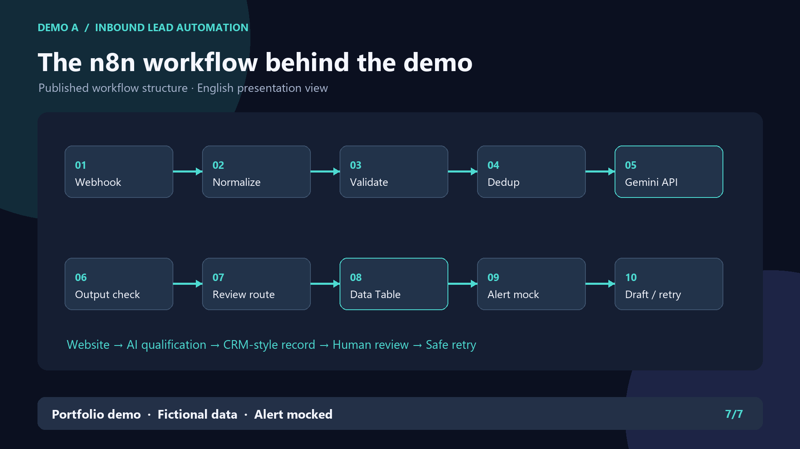
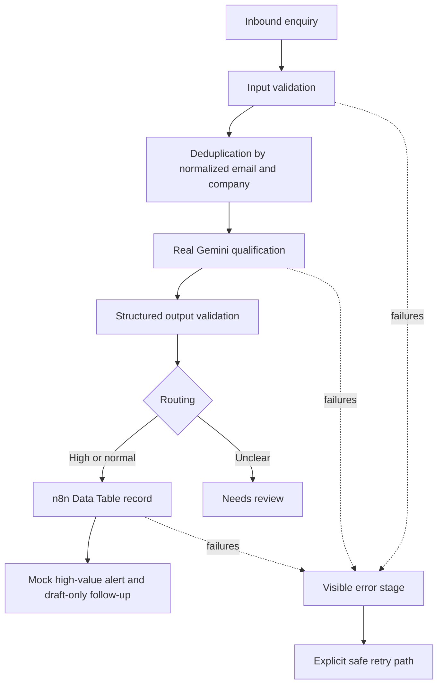

# Inbound Lead Automation with n8n + Gemini

**Website enquiries into your CRM — once, qualified, never lost.**

This portfolio project demonstrates an inbound-lead workflow that validates enquiries, blocks normal duplicate submissions before another AI call, qualifies leads with a real Google Gemini API integration, routes unclear cases for review, and handles tested failure/retry paths. It uses fictional test data.

## What problem this solves

Small B2B service teams can lose time copying website enquiries, spotting repeats and deciding which leads need attention. The demo shows one reviewable path from intake to a saved record, with visible failure stages.

## Workflow

The [sanitized n8n workflow export](workflow/demo-a-sanitized.json) shows the node-level implementation. Credential references are placeholders; reconnect your own credentials in a separate instance before running it.

## What is real

The local tests exercised n8n webhooks, Data Tables, a Google Gemini API call, structured-output checks, review routing, sequential deduplication and retry. The demo uses **n8n Data Table as a CRM-style persistence layer**.

## What is mocked

The high-value notification is a mock record. The follow-up remains `draft_only`; no email is automatically sent to a lead.

## Reliability features

Input and AI output are validated, repeat submissions are checked before another AI call, failed stages remain visible, and tested retries avoid a second CRM record. See [Architecture](docs/ARCHITECTURE.md).

## Test evidence

**10/10 test scenarios passed** locally. Validation recorded **8 successful real Gemini API calls**. The [test summary](docs/TEST_SUMMARY.md) separates observed results from limits.

## 60-second demo

[Watch the 60-second portfolio explainer](media/demo_60s.mp4) · [Preview](media/demo-preview.png)

The video is an edited explainer based on verified workflow results; it is not a continuous live screen recording.

## Case study

[Read the one-page case study](docs/CASE_STUDY.md) or [open the PDF](docs/CASE_STUDY.pdf).

## Known limitations

The n8n implementation demonstrates duplicate prevention for normal repeated submissions. These tests do not establish exactly-once delivery under concurrent requests. The sanitized export uses credential placeholders and is provided to inspect the workflow structure.

## About

Created by **Grant Yang**. Portfolio demo with fictional data; the CRM in the demo is an n8n Data Table and the alert is mocked. See [NOTICE](NOTICE.md) for attribution and licensing context. This repository is published as a portfolio demonstration; no repository-wide licence is granted. **The sole MIT-licensed file is [`workflow/demo-a-sanitized.json`](workflow/demo-a-sanitized.json), under its [file-specific license](workflow/demo-a-sanitized.json.LICENSE.md).** The README, documentation, images, video, and other original materials remain all rights reserved.
